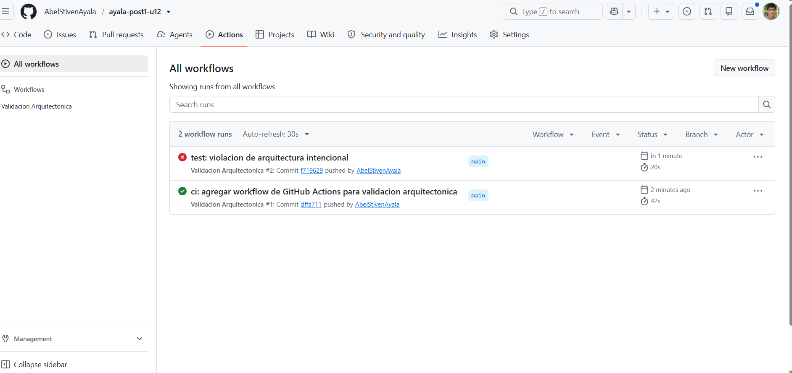
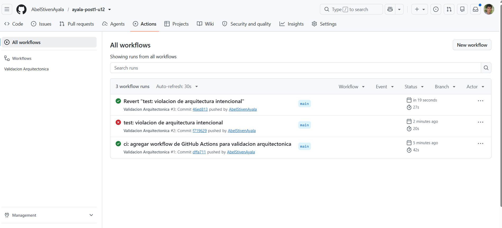

# apellido-post1-u12 — Proyecto Integrador: Sistema de Solicitudes de Reembolso de Gastos Corporativos

Post-contenido Unidad 12 · Patrones de Diseño de Software
Autor: _NOMBRE APELLIDO_ · Código: _CODIGO_

Sistema Spring Boot 3 (Java 17, Maven, H2) con arquitectura en capas simples y tres patrones de comportamiento elegidos a partir de los requisitos de Finanzas: **Chain of Responsibility** (validación), **Strategy** (cálculo por categoría) y **Observer** (notificaciones). La Parte 2 documenta la decisión arquitectónica (ADR-001), verifica los límites entre paquetes con ArchUnit en GitHub Actions y cierra con un análisis de lo que se descartó por sobreingeniería.

---

## 1. Diseño Propuesto

> Esta sección se escribió **antes** de programar cualquier patrón (commit 1 del historial).

| Requisito | Qué varía (punto de variabilidad) | Patrón | Justificación |
|-----------|-----------------------------------|--------|---------------|
| **RF1** Validación en varias etapas | El conjunto y el orden de verificaciones previas a la aprobación: hoy son tres (monto, documentos, duplicados) y Finanzas ya anunció una cuarta (límite anual acumulado). | **Chain of Responsibility** | Cada verificación es un eslabón independiente que rechaza o pasa la solicitud al siguiente, de modo que agregar el límite anual es crear un eslabón nuevo y enlazarlo, sin modificar los existentes. |
| **RF2** Cálculo por categoría | La fórmula del monto aprobado, distinta para viáticos, representación y capacitación, y con una cuarta categoría ("bienestar") prevista. | **Strategy** | Cada categoría es una estrategia intercambiable que encapsula su fórmula, así una categoría nueva es una clase nueva y ninguna fórmula existente se toca. |
| **RF3** Notificación a varios interesados | Quién reacciona a un cambio de estado y cómo: el empleado (siempre), Contabilidad (solo aprobaciones), Auditoría (todo) y un panel de métricas en camino. | **Observer** | Cada interesado se suscribe con su propia reacción, de modo que el servicio publica el cambio de estado una sola vez sin conocer cuántos ni cuáles son los interesados. |

**Por qué estos patrones y no otros**

- RF1: una cadena y no un único método con tres `if` porque el requisito exige crecer sin modificar lo ya escrito; un `if` más sí obligaría a tocar el método existente.
- RF2: Strategy y no un `switch` sobre `CategoriaGasto` porque la variabilidad es la fórmula completa, y las categorías nuevas ya están anunciadas (ver Decisión de diseño 2).
- RF3: Observer y no llamadas directas a tres clases porque el número de interesados crece (panel de métricas) y cada uno reacciona distinto a los mismos eventos.

---

## 2. Arquitectura resultante

```
com.empresa.reembolsos
├── dominio/            SolicitudReembolso, CategoriaGasto, EstadoSolicitud   (sin Spring ni JPA)
├── procesamiento/
│   ├── validacion/     ValidadorSolicitud (+ 3 validadores), CadenaValidadores   [Chain of Responsibility]
│   ├── calculo/        CalculadoraReembolso (+ 3 calculadoras), SelectorCalculadora [Strategy]
│   └── notificacion/   ObservadorCambioEstado (+ 3 notificadores)                 [Observer]
├── aplicacion/         SolicitudReembolsoService (único punto que coordina los 3 patrones)
├── infraestructura/    RepositorioSolicitudesJpa
└── adaptadores/rest/   SolicitudReembolsoController, ManejadorErrores
```

Flujo de `crear`: el servicio carga las pendientes del empleado → `CadenaValidadores` → `SelectorCalculadora` → guarda.
Flujo de `cambiarEstado`: el servicio guarda el nuevo estado → notifica a todos los `ObservadorCambioEstado`.

---

## 3. Decisiones de diseño de la Parte 1

### Decisión de diseño 1 — Orden de la cadena de validadores

**Orden elegido:** documentos → monto → duplicados.

- **Qué se gana:** las verificaciones más baratas van primero (un booleano y una búsqueda en un `Map`) y la más costosa (recorrer la lista de pendientes del empleado) solo se ejecuta si las anteriores ya pasaron; una solicitud sin documentos o con monto excesivo se rechaza sin recorrer esa lista (fail-fast).
- **Qué se pierde:** el empleado ve un solo motivo de rechazo a la vez (el primero que falla) y, si corrige y reenvía, puede descubrir otro error después. Poner duplicados primero tendría el costo contrario: se pagaría la comparación más cara incluso para solicitudes que serían rechazadas por algo trivial.
- **Matiz honesto:** hoy la consulta a base de datos de las pendientes ocurre en el servicio *antes* de entrar a la cadena, así que el ahorro real es solo el recorrido en memoria, que es pequeño. El orden es correcto por principio (barato primero), pero el beneficio medible sería mayor si la lista se cargara de forma perezosa (ver "Qué se descartó y por qué").

### Decisión de diseño 2 — `Map` inyectado vs. `switch` manual para elegir la calculadora

**Elección:** `SelectorCalculadora` construye un `Map<CategoriaGasto, CalculadoraReembolso>` a partir de la `List<CalculadoraReembolso>` que Spring inyecta con todos los `@Component`.

- El RF2 pide agregar categorías **sin modificar el código existente**. Con el mapa, una categoría nueva ("bienestar") se resuelve creando una clase `CalculadoraBienestar` anotada con `@Component` y agregando el valor al enum `CategoriaGasto`; `SelectorCalculadora` no cambia.
- Con un `switch` sobre `CategoriaGasto` habría que editar el método del `switch` en cada categoría nueva, es decir, tocar código ya escrito y probado (viola el principio abierto/cerrado que el requisito pide explícitamente).
- Costo aceptado: el mapa se construye al arrancar y una categoría sin calculadora falla en tiempo de ejecución (`IllegalArgumentException: Categoria no soportada`) y no en compilación como haría un `switch` exhaustivo sobre un enum. Se acepta porque el `SelectorCalculadora` lo informa con un mensaje claro y porque el flujo de integración prueba las tres categorías.

---

## 4. Decisión arquitectónica — ADR-001 (resumen)

Documento completo: [`docs/adr/ADR-001.md`](docs/adr/ADR-001.md).

- **Persistencia:** capas simples. `SolicitudReembolsoService` depende directamente de `RepositorioSolicitudesJpa`; no se introduce un puerto `RepositorioSolicitudes` con adaptador porque no existe ningún plan de cambiar de motor de base de datos (YAGNI) y el criterio de la Guía (sistema con 3+ años de vida y cambios de infraestructura) no se cumple para la persistencia.
- **Notificación:** sin cambios. `ObservadorCambioEstado` ya es el punto de extensión; la integración externa que anunció Contabilidad se resuelve reemplazando el interior de `NotificadorContabilidad`, sin tocar el servicio ni los demás observadores.
- **Deuda aceptada:** si el motor de base de datos cambia, el puerto se introduce retroactivamente.

Esta es la **Decisión de diseño 3**.

---

## 5. Reglas de arquitectura (ArchUnit)

`ReglasArquitectura` verifica cuatro reglas con nombres descriptivos:

| Regla | Qué garantiza |
|-------|---------------|
| `procesamientoSinPersistenciaNiWeb` | `procesamiento` no depende de `infraestructura`, `adaptadores`, `org.springframework.data` ni `jakarta.persistence`. |
| `controladorSoloUsaServicio` | `adaptadores.rest` solo accede a `aplicacion`, `dominio`, Spring Web/HTTP y `java`. |
| `calculadorasImplementanInterfaz` | Toda clase de `procesamiento.calculo` (salvo el selector) implementa `CalculadoraReembolso`. |
| `notificadoresImplementanInterfaz` | Toda clase de `procesamiento.notificacion` implementa `ObservadorCambioEstado`. |

Las reglas se analizan sin incluir las clases de prueba (`ImportOption.DoNotIncludeTests`), y la regla 3 excluye a `SelectorCalculadora`, que vive en el mismo paquete pero es el consumidor de las estrategias, no una de ellas.

### Decisión de diseño 4 — Qué prohíbe (y qué no) la Regla 1

La regla prohíbe `org.springframework.data` y `jakarta.persistence`, pero no todo `org.springframework`, porque lo que se quiere proteger es la **dirección de las dependencias**, no la ausencia de la palabra "Spring":

- Las anotaciones de estereotipo (`@Component`) son metadatos para el contenedor de inyección. No acoplan el código a una base de datos ni a un protocolo: las clases siguen siendo objetos simples que se prueban con `new` (los tests unitarios no levantan Spring).
- Las clases de acceso a datos (`Repository`, `JpaRepository`, `EntityManager`, `@Entity`) y las de la capa web (`@RestController`, `ResponseEntity`) sí atan `procesamiento` a *dónde* se guardan los datos y a *cómo* se entregan. Eso es justo lo que la regla quiere impedir.
- Prohibir todo `org.springframework` obligaría a cablear los patrones con clases de configuración manual, ruido sin ganancia real de desacoplamiento, y rompería la regla con usos legítimos.

---

## 6. Qué se descartó y por qué

> Cada descarte es una decisión vigente hoy, no definitiva: se indica la señal que haría reconsiderarla.

### 6.1 `ApplicationEventPublisher` en vez de la lista de observadores inyectada
- **Qué se consideró:** publicar un evento de dominio con `ApplicationEventPublisher` y `@EventListener`, en lugar de inyectar `List<ObservadorCambioEstado>` en el servicio.
- **Por qué se descartó:** hay exactamente tres observadores, conocidos en tiempo de compilación; un bus de eventos genérico no agrega desacoplamiento real (ya lo da la interfaz) y sí dificulta rastrear quién reacciona a qué cambio.
- **Señal para reconsiderar:** que los observadores deban ejecutarse de forma asíncrona o transaccional (`@TransactionalEventListener`), o que aparezcan listeners en módulos que no deban conocerse entre sí.

### 6.2 Visitor o Abstract Factory para exportar reportes en varios formatos
- **Qué se consideró:** anticipar que Contabilidad pediría exportar a PDF y Excel además de CSV y construir una jerarquía de exportadores.
- **Por qué se descartó:** solo existe el requisito de CSV; no hay una segunda solicitud real de otro formato, por lo que no se cumple la Rule of Three.
- **Señal para reconsiderar:** un segundo formato pedido por un usuario real; con el tercero, extraer la abstracción.

### 6.3 Puerto de persistencia con adaptador JPA (Hexagonal completa)
- **Qué se consideró:** interfaz `RepositorioSolicitudes` en el dominio y adaptador JPA en infraestructura, para que ningún servicio conociera JPA.
- **Por qué se descartó:** no hay plan de cambiar de motor; sería una abstracción especulativa (YAGNI) con interfaz, mapper y duplicación de pruebas sin un caso de uso que la exija (ver ADR-001).
- **Señal para reconsiderar:** una fecha concreta de migración de base de datos o un segundo almacenamiento (por ejemplo, un servicio externo de datos).

### 6.4 (Elemento propio) Carga perezosa de las solicitudes pendientes con `Supplier`
- **Qué se consideró:** cambiar la firma de los validadores para recibir un `Supplier<List<SolicitudReembolso>>` y que la consulta de pendientes solo se ejecute si `ValidadorDuplicados` llega a correr, aprovechando el orden de la cadena (Decisión 1).
- **Por qué se descartó:** el ahorro es una consulta indexable por empleado y estado, que hoy cuesta casi nada con el volumen de una empresa mediana; la firma con `Supplier` haría menos legibles los tres validadores solo para optimizar un costo que no se ha medido.
- **Señal para reconsiderar:** una medición real (por ejemplo, la consulta aparece entre las más lentas del perfil) o que se agregue un validador que consulte un servicio remoto y caro.

---

## 7. Evidencia del pipeline (GitHub Actions)

Workflow: `.github/workflows/arquitectura.yml`. Se introdujo una violación intencional de la Regla 1 (`ValidadorDuplicados` con un campo de tipo `RepositorioSolicitudesJpa`), se verificó que el job fallaba y se revirtió.

**Build en rojo por la violación intencional**



**Build en verde tras el `git revert`**



---

## 8. Notas técnicas

- **Dominio sin JPA:** `SolicitudReembolso` no importa ninguna clase de Spring ni de JPA. Su mapeo a base de datos se declara en `src/main/resources/META-INF/orm.xml` (referenciado con `spring.jpa.mapping-resources`), de modo que el repositorio `JpaRepository<SolicitudReembolso, Long>` funciona sin anotar la clase de dominio.
- **CI:** se usa la caché de Maven integrada de `actions/setup-java@v4` (`cache: maven`).

## 9. Cómo ejecutar

```
mvn clean test          # todas las pruebas (unitarias, integración y ArchUnit)
mvn spring-boot:run     # levanta la API en http://localhost:8080
```

| Método | Ruta | Descripción |
|--------|------|-------------|
| POST | `/api/solicitudes` | Crea una solicitud (valida y calcula el monto aprobado). |
| PUT | `/api/solicitudes/{id}/estado` | Cambia el estado y notifica a los tres observadores (el cuerpo es un JSON string, por ejemplo `"APROBADA"`). |
